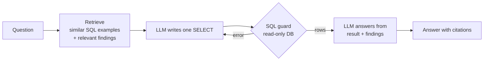

# BankSight: Retail Banking Customer and Financial Analytics

A data analyst portfolio project analyzing a relational synthetic banking dataset
(50,000 customers, 75,000 accounts, 100,000 cards, 30,000 loans, 1,000,000
transactions, 2019 to 2025) using SQL, Python, and Power BI.

The project builds a Customer 360 view, one row per customer summarizing their
accounts, cards, loans, and transaction activity, then uses that view to segment
customers by value and engagement, test expected relationships in the data, and
flag unusual transactions for review. All of it is presented in a three-page
Power BI dashboard designed for a business audience.

## Key Findings

1. The data is clean and reliable: zero nulls, duplicates, or broken foreign keys across all six connected tables.
2. Most customers hold only one or two products out of three possible categories (accounts, cards, loans), pointing to a real cross-sell opportunity.
3. Segmenting customers by value and engagement, rather than credit risk alone, splits the full 50,000-customer base into four actionable groups, from Loyal High-Value down to Low-Value Low-Engagement.
4. Credit score showed little relationship with loan interest rates in this synthetic dataset. Because the data is synthetic, this is not evidence of a real lending issue, but a relationship this flat would warrant investigation in production data.
5. About 0.1% of transactions are unusually large and worth manual review, though they are not confirmed fraud and should not be treated as such on their own.

Full write-up: [`reports/ANALYSIS_REPORT.md`](reports/ANALYSIS_REPORT.md) for the analyst report, or [`reports/FINDINGS_PLAIN_LANGUAGE.md`](reports/FINDINGS_PLAIN_LANGUAGE.md) for findings and recommendations in plain language.

## Ask BankSight: AI Assistant (RAG + Text-to-SQL)

`assistant/` adds a plain-English question-answering layer on top of the analysis.
A business user asks a question; the assistant retrieves the most relevant
findings and example queries from this repo, writes a SQL query, runs it safely,
and answers with numbers from the result plus citations.



```
$ python -m assistant ask "Which merchants bring in the most transaction value?" --show-sql
$ python -m assistant ask "Why should the bank care that customers hold few products?"
```

**How it works**

- **Retrieval (RAG):** `sql/queries.sql` is split into business-question/query pairs, and `reports/FINDINGS.md` into sections. TF-IDF search pulls the 3 closest example queries and 2 closest findings for each question.
- **Grounded SQL generation:** the model sees the live database schema, including the allowed values of short text columns such as `account_type`, plus the retrieved examples as few-shot guidance, so it uses the real table and column names.
- **Safety:** only a single `SELECT`/`WITH` statement is accepted. The database is opened read-only, and every query has a row cap and a time limit. A model that tries `DELETE` or `DROP` is blocked, which the tests check.
- **Self-correction:** if a query fails (for example, a wrong column name), the error goes back to the model once so it can fix the query.
- **No SQL when not needed:** questions about meaning or recommendations are answered from the findings alone.
- **Evaluation:** `python -m assistant eval` measures *execution accuracy*: the generated query and a hand-written gold query must return the same values.

**Running it**

```
pip install -r requirements.txt
python -m pytest -q                       # 24 tests, offline
python -m assistant ask "What is our card product mix?" --show-sql   # offline mock model

# With a real model
set ANTHROPIC_API_KEY=...                 # PowerShell: $env:ANTHROPIC_API_KEY="..."
python -m assistant --provider anthropic ask "Which account type holds the most balance?" --show-sql
python -m assistant --provider anthropic eval
```

The assistant uses the Kaggle database at `data/raw/banking_dataset_kaggle/data/database/bank_sqlite.db`
when it is present. Otherwise it generates a small sample database with the same core tables
(`python -m assistant.sample_db`), so tests and CI run without the 650MB download.
The offline mock model reuses the best retrieved example query; it scores 5 of 6 on
the eval because the remaining question needs new SQL that only a real model can write.

## Dashboard

`BankSight-Dashboard.pbix` is a three-page Power BI dashboard built on a relational
data model (7 relationships across 7 tables, including the Customer 360 table):

1. **Executive Overview**: portfolio-level KPIs, balance by account type, monthly transaction trend, customer segment distribution
2. **Customer and Product Analytics**: customers by segment, average balance by segment, product adoption, credit score distribution
3. **Transactions and Lending**: monthly transaction value, top merchants, credit band vs. average interest rate, unusually large transactions

Static chart exports are in [`figures/`](figures/).

## Repository Structure

```
├── assistant/                       # Ask BankSight: RAG + text-to-SQL assistant
│   ├── agent.py                    # retrieve -> write SQL -> run safely -> answer
│   ├── knowledge.py                # retrieval over findings and example queries
│   ├── sql_guard.py                # SELECT-only validation, read-only execution
│   ├── llm.py                      # Anthropic / OpenAI / offline mock clients
│   ├── evaluate.py                 # execution-accuracy evaluation
│   └── sample_db.py                # small sample DB for tests and demos
├── tests/                           # pytest suite for the assistant
├── notebooks/
│   └── banking_analysis.ipynb      # Full narrated SQL + Python analysis
├── src/                             # Reproducible analysis scripts
│   ├── 01_data_quality.py
│   ├── 02_sql_queries.py
│   ├── 03_customer_360.py          # Builds the customer-level rollup table
│   ├── 04_segmentation.py          # Value and engagement segmentation
│   ├── 05_anomaly_detection.py
│   ├── 06_export_for_powerbi.py
│   └── 07_visualize.py
├── sql/
│   └── queries.sql                 # Business-question SQL, organized by topic
├── figures/                         # Chart exports
├── reports/
│   ├── ANALYSIS_REPORT.md          # Formal analyst report
│   └── FINDINGS_PLAIN_LANGUAGE.md  # Findings and recommendations, plain language
├── BankSight-Dashboard.pbix        # Power BI dashboard, 3 pages
├── requirements.txt
├── .gitignore
└── data/                           # Not tracked in git, see below
```

## Getting the Data

Raw data (about 650MB) exceeds GitHub's size limits and isn't tracked in this repo.
Search Kaggle for "synthetic banking dataset," or use your own copy of the source
archive, and place its contents at `data/raw/banking_dataset_kaggle/`. Running the
scripts in `src/` in order regenerates everything under `data/cleaned/`, including
`customer_360.csv`, the table the dashboard and segmentation are built on.

## Tools and Skills Demonstrated

- SQL (SQLite): joins, aggregations, CASE-based binning, subqueries, referential integrity checks, customer-level rollups across multiple tables
- Python: pandas, sqlite3, matplotlib, seaborn, feature engineering (Customer 360 rollup, engagement scoring)
- Power BI: data modeling (relationships, cardinality), DAX calculated columns, a three-page executive dashboard
- Analysis technique: testing an assumption before building on it (checking whether credit score actually predicts interest rate, checking distribution shape before choosing an anomaly detection method), customer segmentation by value and engagement rather than risk alone
- AI / LLM: retrieval-augmented generation, text-to-SQL, few-shot prompting, guardrails on model-written SQL, self-correction, execution-accuracy evaluation, Anthropic and OpenAI APIs
- Communication: findings written with business meaning and a recommendation attached to each one, for both technical and non-technical audiences

## Reproducing This Analysis

```
python -m venv venv
.\venv\Scripts\Activate.ps1
python -m pip install -r requirements.txt

python src\01_data_quality.py
python src\02_sql_queries.py
python src\03_customer_360.py
python src\04_segmentation.py
python src\05_anomaly_detection.py
python src\06_export_for_powerbi.py
```

Then open `notebooks/banking_analysis.ipynb` for the full narrated analysis, or
`BankSight-Dashboard.pbix` in Power BI Desktop for the interactive dashboard.