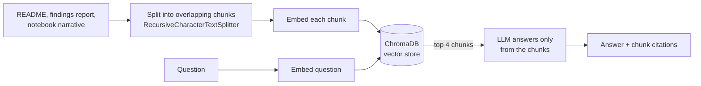

# BankSight: Retail Banking Customer and Financial Analytics

A data analyst portfolio project analyzing a relational synthetic banking dataset
(50,000 customers, 75,000 accounts, 100,000 cards, 30,000 loans, 1,000,000
transactions, 2019 to 2025) using SQL, Python, and Power BI.

The project builds a Customer 360 view, one row per customer summarizing their
accounts, cards, loans, and transaction activity, then uses that view to segment
customers by value and engagement, test expected relationships in the data, and
flag unusual transactions for review. All of it is presented in a three-page
Power BI dashboard designed for a business audience.

## Key Findings

1. The data is clean and reliable: zero nulls, duplicates, or broken foreign keys across all six connected tables.
2. Most customers hold only one or two products out of three possible categories (accounts, cards, loans), pointing to a real cross-sell opportunity.
3. Segmenting customers by value and engagement, rather than credit risk alone, splits the full 50,000-customer base into four actionable groups, from Loyal High-Value down to Low-Value Low-Engagement. A KMeans clustering of the same customers (step 7) checks whether these four tiers also emerge from the data on their own; see [`reports/KMEANS_SEGMENTS.md`](reports/KMEANS_SEGMENTS.md).
4. Credit score showed little relationship with loan interest rates in this synthetic dataset. Because the data is synthetic, this is not evidence of a real lending issue, but a relationship this flat would warrant investigation in production data.
5. About 0.1% of transactions are unusually large and worth manual review, though they are not confirmed fraud and should not be treated as such on their own.

Full write-up: [`reports/FINDINGS.md`](reports/FINDINGS.md) explains each finding, its business meaning and a recommendation, in plain language.

## Ask BankSight: AI Assistants (LangChain, ChromaDB, Text-to-SQL)

`assistant/` adds three ways to ask the project questions in plain English, plus an HTTP API.

| Assistant | What it answers | How |
|---|---|---|
| **Document RAG** (`docs_rag.py`) | "What did the analysis find about cross-selling?" | LangChain + ChromaDB over the project's unstructured documents |
| **SQL tool agent** (`sql_agent.py`) | "Which merchants bring in the most value?" | The model *chooses* among predefined SQL queries exposed as tools |
| **Text-to-SQL** (`agent.py`) | "How many Business accounts hold over $50k?" | The model *writes* a new SELECT, run on a read-only connection |

### 1. Document RAG with LangChain and ChromaDB



- **Loading:** the README, `reports/FINDINGS.md` and the markdown cells of the notebook (the narrative, not the code), which are messy, unstructured text.
- **Chunking:** about 800-character chunks with 120 characters of overlap, split on headings first so each chunk stays on one topic. Each chunk gets an id such as `reports/FINDINGS.md#3`.
- **Embeddings:** `fastembed` (BAAI/bge-small-en-v1.5, runs locally on CPU with no API key), `openai`, or `hashing` (a deterministic offline option used by the tests).
- **Grounding:** the prompt allows answers only from the retrieved chunks, requires citing chunk ids, and asks the model to say when the documents don't contain the answer.

```
python -m assistant index --embeddings fastembed                      # build the Chroma index (data/chroma/)
python -m assistant --provider anthropic docs "How were customers segmented?" --embeddings fastembed
```

### 2. Tool-calling agent over predefined SQL

Each business question in `sql/queries.sql` becomes a LangChain tool, with the question as its description. The model sees the tool list (via `bind_tools`), calls the tool(s) that fit, gets the rows back, and answers from them. It runs for up to 3 steps. The tools take no arguments, so the model can choose a query but can never change the SQL. Unknown tool names are reported back instead of executed, and questions that match no query get "no tool fits" instead of a guess.

```
python -m assistant --provider anthropic agent "Which account type holds the most balance?"
```

### 3. Text-to-SQL with guardrails

The model writes a new query when no predefined one fits:

- **Retrieval:** similar example queries and relevant findings are retrieved and shown to the model as few-shot guidance.
- **Schema:** the model sees the live database schema, including the allowed values of short text columns such as `account_type`.
- **Safety:** only one `SELECT`/`WITH` statement is accepted. It runs on a read-only connection with a row cap and a time limit.
- **Self-correction:** a failed query goes back to the model once, with the error, so it can fix it.
- **Evaluation:** `python -m assistant eval` measures *execution accuracy*: the generated query and a hand-written gold query must return the same values.

```
python -m assistant ask "Which merchants bring in the most transaction value?" --show-sql
python -m assistant --provider anthropic eval
```

### HTTP API (FastAPI)

```
uvicorn assistant.api:create_app --factory          # interactive docs at http://127.0.0.1:8000/docs
```

| Endpoint | Assistant |
|---|---|
| `POST /ask` | text-to-SQL (returns the answer, the SQL and up to 20 rows) |
| `POST /docs/ask` | document RAG (returns the answer and the cited chunks) |
| `POST /agent/ask` | tool-calling agent (returns the answer and the tools it used) |
| `GET /health` | provider, embeddings and database in use |

Configure it with the `BANKSIGHT_PROVIDER` (`mock`, `anthropic`, `openai`), `BANKSIGHT_EMBEDDINGS` (`hashing`, `fastembed`, `openai`) and `BANKSIGHT_DB` environment variables.

### Running and testing

```
pip install -r requirements.txt
python -m pytest -q        # 47 tests, fully offline: mock models, hashing embeddings, generated sample DB

# With a real model (PowerShell)
$env:ANTHROPIC_API_KEY="..."      # or OPENAI_API_KEY with --provider openai
```

Everything uses the Kaggle database at `data/raw/banking_dataset_kaggle/data/database/bank_sqlite.db`
when it's present. Otherwise it generates a small sample database with the same core tables
(`python -m assistant.sample_db`), so the tests and CI run without the 650MB download. Without an API key,
`--provider mock` (the default) uses offline stand-ins: the document RAG quotes the best chunks, and the agent
picks the closest-matching query by TF-IDF. That shows the pipeline working, but it isn't a measure of answer quality.

## Dashboard

`BankSight-Dashboard.pbix` is a three-page Power BI dashboard built on a relational
data model (7 relationships across 7 tables, including the Customer 360 table):

1. **Executive Overview**: portfolio-level KPIs, balance by account type, monthly transaction trend, customer segment distribution
2. **Customer and Product Analytics**: customers by segment, average balance by segment, product adoption, credit score distribution
3. **Transactions and Lending**: monthly transaction value, top merchants, credit band vs. average interest rate, unusually large transactions

Static chart exports are in [`figures/`](figures/).

## Repository Structure

```
├── assistant/                       # Ask BankSight: AI assistants + API
│   ├── docs_rag.py                 # LangChain + ChromaDB RAG over the project documents
│   ├── sql_agent.py                # tool-calling agent over predefined SQL queries
│   ├── models.py                   # LangChain chat models and embeddings (fastembed / openai / hashing)
│   ├── api.py                      # FastAPI service
│   ├── agent.py                    # text-to-SQL: retrieve -> write SQL -> run safely -> answer
│   ├── knowledge.py                # retrieval over findings and example queries
│   ├── sql_guard.py                # SELECT-only validation, read-only execution
│   ├── llm.py                      # Anthropic / OpenAI / offline mock clients
│   ├── evaluate.py                 # execution-accuracy evaluation
│   └── sample_db.py                # small sample DB for tests and demos
├── tests/                           # pytest suite (assistants, API, clustering)
├── notebooks/
│   └── banking_analysis.ipynb      # Full narrated SQL + Python analysis
├── src/                             # Reproducible analysis scripts
│   ├── 01_data_quality.py
│   ├── 02_sql_queries.py
│   ├── 03_customer_360.py          # Builds the customer-level rollup table
│   ├── 04_segmentation.py          # Value and engagement segmentation
│   ├── 05_anomaly_detection.py
│   ├── 06_export_for_powerbi.py
│   ├── 07_visualize.py
│   └── kmeans_segmentation.py      # KMeans tiers + assumption checks, compared with step 4
├── sql/
│   └── queries.sql                 # Business-question SQL, organized by topic
├── figures/                         # Chart exports
├── reports/
│   ├── FINDINGS.md                 # Findings and recommendations, plain language
│   └── KMEANS_SEGMENTS.md          # Generated by src/kmeans_segmentation.py
├── BankSight-Dashboard.pbix        # Power BI dashboard, 3 pages
├── requirements.txt
├── .gitignore
└── data/                           # Not tracked in git, see below
```

## Getting the Data

Raw data (about 650MB) exceeds GitHub's size limits and isn't tracked in this repo.
Search Kaggle for "synthetic banking dataset," or use your own copy of the source
archive, and place its contents at `data/raw/banking_dataset_kaggle/`. Running the
scripts in `src/` in order regenerates everything under `data/cleaned/`, including
`customer_360.csv`, the table the dashboard and segmentation are built on.

## Tools and Skills Demonstrated

- SQL (SQLite): joins, aggregations, CASE-based binning, subqueries, referential integrity checks, customer-level rollups across multiple tables
- Python: pandas, sqlite3, matplotlib, seaborn, feature engineering (Customer 360 rollup, engagement scoring)
- Machine learning: KMeans clustering with skew checks, log transforms and scaling, silhouette scores to compare k, and adjusted Rand index against the rule-based segments
- Power BI: data modeling (relationships, cardinality), DAX calculated columns, a three-page executive dashboard
- Analysis technique: testing an assumption before building on it (checking whether credit score actually predicts interest rate, checking distribution shape before choosing an anomaly detection method), customer segmentation by value and engagement rather than risk alone
- AI / LLM: LangChain, ChromaDB vector search, embeddings, chunking, retrieval-augmented generation, tool calling, text-to-SQL, few-shot prompting, guardrails, self-correction, execution-accuracy evaluation, Anthropic and OpenAI APIs
- APIs and testing: FastAPI, pytest (47 offline tests), GitHub Actions
- Communication: findings written with business meaning and a recommendation attached to each one, for both technical and non-technical audiences

## Reproducing This Analysis

```
python -m venv venv
.\venv\Scripts\Activate.ps1
python -m pip install -r requirements.txt

python src\01_data_quality.py
python src\02_sql_queries.py
python src\03_customer_360.py
python src\04_segmentation.py
python src\05_anomaly_detection.py
python src\06_export_for_powerbi.py
python src\kmeans_segmentation.py
```

Then open `notebooks/banking_analysis.ipynb` for the full narrated analysis, or
`BankSight-Dashboard.pbix` in Power BI Desktop for the interactive dashboard.